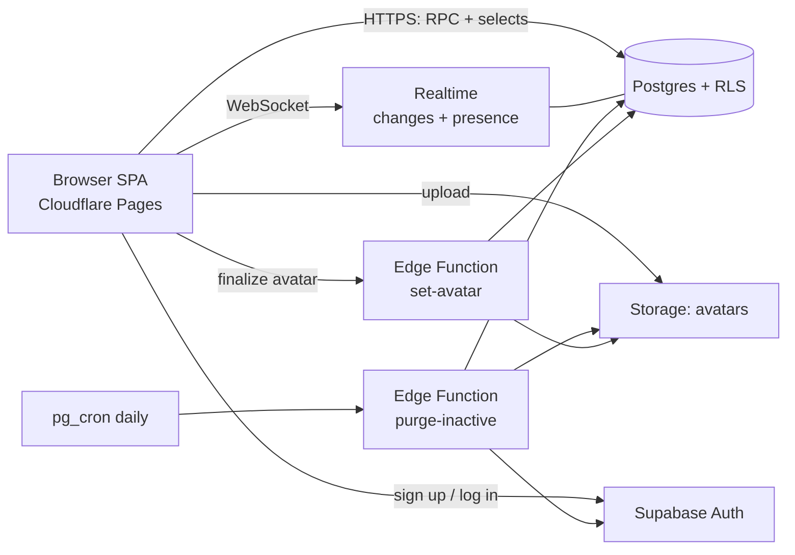

# Taskahan Architecture

Taskahan is a live group task tracker. Every member of a group owns a column of tasks, and everyone in the group sees every column update in real time. This document fixes the stack, the data model, and the rules the code must follow. Security rules are detailed in [SECURITY.md](SECURITY.md), the interface in [DESIGN.md](DESIGN.md), product facts in [PRODUCT.md](PRODUCT.md).

## 1. Stack decisions

| Layer | Choice | Why |
|---|---|---|
| Backend | **Supabase** (Postgres, Auth, Realtime, Storage, Edge Functions, pg_cron) | The data is relational (groups, memberships, tasks, threads, logs) and the hard rules are permission rules. Postgres row level security plus SQL functions express them in one place. Realtime Presence gives online/offline for free, and pg_cron runs the 30-day cleanup without a paid plan. |
| Not Firebase | | Firestore would need denormalized documents and security rules that cannot express "one leader per group" or "append-only log" atomically. Scheduled deletion needs Cloud Functions, which requires the paid Blaze plan, as does Cloud Storage on new projects. |
| Frontend | **React + Vite + TypeScript**, single-page app | The whole product is behind login, so there is nothing to server-render or index. A static bundle is the simplest thing that works. |
| Hosting | **Cloudflare Pages** | Static files only. The free tier has no bandwidth cap and no non-commercial clause. Turnstile (bot check on sign up) comes from the same account. Vercel works identically if preferred: the only change is the SPA rewrite and headers file format. |
| Styling | Tailwind CSS v4, tokens as CSS custom properties | Tokens come from DESIGN.md and switch by `data-theme` for light and dark. |
| Data fetching | TanStack Query + `@supabase/supabase-js` | Query cache is the single client-side source of truth; realtime events patch it. |
| Validation | Zod on the client, SQL checks on the server | The server never trusts the client's copy. |
| Avatar crop | `react-easy-crop` + canvas | Crop, zoom, preview, resize and compress all happen in the browser before upload. |
| Charts | Hand-built with CSS flex | Task Progress is a stacked bar per member. A chart library would be larger than the feature. |
| Fonts | Self-hosted via Fontsource | No third-party font requests, which keeps the content security policy tight. |
| Tests | pgTAP (database rules), Vitest (units), Playwright (end to end, two browser contexts for realtime) | |



## 2. Core idea: membership is the durable identity

Accounts are disposable (no email, no password recovery, deleted after 30 inactive days). History is not. So nothing inside a group ever points at an account. Everything points at a **membership** row.

- A membership is "this person's seat in this group". It holds the display name, the role, and a status of `active` or `former`.
- Tasks, chat messages, thread replies and logs reference `membership.id`.
- `membership.user_id` is the only link to an account. It is used for access checks and is set to `NULL` when the account is deleted. The membership row itself is never deleted while the group exists.
- When someone leaves, is removed, or their account is purged, the membership flips to `former`. The column stays on the board as "#Name · Former member" with its tasks and messages intact. Access ends because every access check requires `status = 'active'`.
- A returning person joins with a new account, gets a new membership, and uses **Take over** to move tasks from their former column.

Roles live on the membership, so one account can lead Group A and be a member of Group B.

## 3. Data model

All tables are in `public`, all have row level security enabled. Every group-scoped table carries `group_id` so realtime subscriptions can filter on it.

### profiles
One row per account. Created by a trigger on `auth.users`.

| Column | Type | Notes |
|---|---|---|
| id | uuid PK | references `auth.users(id)` on delete cascade |
| username | citext unique | 3 to 20 chars, `a-z 0-9 _`, immutable |
| avatar_path | text null | object path in the `avatars` bucket |
| theme | text | `system`, `light`, `dark` |
| last_active_at | timestamptz | drives the 30-day rule |
| created_at | timestamptz | |

### groups

| Column | Type | Notes |
|---|---|---|
| id | uuid PK | |
| name | text | 1 to 40 chars |
| purpose | enum | `student_project`, `work_team`, `club_org`, `other` |
| purpose_note | text null | free text when purpose is `other`, up to 40 chars |
| member_limit | int | 2 to 30, counts active members including the leader |
| join_code | char(8) unique | uppercase A to Z only, chosen by the leader |
| next_task_number | int | per-group task counter |
| next_seat | int | per-group seat counter |
| created_at | timestamptz | |

### memberships

| Column | Type | Notes |
|---|---|---|
| id | uuid PK | the durable identity used everywhere |
| group_id | uuid FK | on delete cascade |
| user_id | uuid null FK | `profiles(id)` on delete set null |
| display_name | text | username at join time, kept forever |
| seat | int | join order within the group, never reused; drives the member's color and number in the UI |
| role | enum | `leader`, `member` |
| status | enum | `active`, `former` |
| joined_at, left_at | timestamptz | |
| left_reason | enum null | `left`, `removed`, `account_deleted` |

Indexes and constraints:
- unique `(group_id, user_id)` where `status = 'active'` (one active seat per account per group)
- unique `(group_id)` where `role = 'leader' and status = 'active'` (exactly one leader)
- a `former` membership always has `role = 'member'`

### group_blocks
`(group_id, user_id)`. Written when a leader removes someone, so that account cannot rejoin with the code. A new account can, which is why removal also offers to change the join code.

### tasks

| Column | Type | Notes |
|---|---|---|
| id | uuid PK | |
| group_id | uuid FK | |
| number | int | permanent per-group number shown as `#12`; unique with group_id |
| title | text | 1 to 120 chars |
| details | text | up to 2000 chars |
| assignee_id | uuid FK | `memberships(id)` |
| status | enum | `todo`, `in_progress`, `done` |
| open_questions | int | maintained by trigger from threads |
| deadline | timestamptz null | |
| created_by | uuid FK | membership |
| created_at, updated_at, completed_at, deleted_at | timestamptz | soft delete only |

**Blocked is derived, not stored.** A task shows as Blocked when `open_questions > 0 and status <> 'done'`. Resolving the last open question returns the task to whatever status it had. This keeps the Task Progress bar honest (Done, In progress, To do are the three segments; Blocked is an indicator on top) and means nobody has to remember to unblock.

### threads and thread_replies
A thread is a question on a task.

| threads | | thread_replies | |
|---|---|---|---|
| id, group_id, task_id | | id, group_id, thread_id | |
| opened_by | membership | author_id | membership |
| body | up to 1000 chars | body | up to 1000 chars |
| status | `open`, `resolved` | created_at | |
| resolved_by, resolved_at | | | |

The assignee opens questions on their own task. The leader and any active member can reply. The opener or the leader can resolve, and either can reopen.

### messages
Group chat. `id, group_id, author_id (membership), body (up to 1000 chars), created_at`. No edits, no deletes in v1.

### logs
`id bigserial, group_id, actor_id (membership, null for system), action, task_id null, target_member_id null, meta jsonb, created_at`.

Append-only. Rows are inserted only from inside the write functions in section 5, in the same transaction as the change they describe. Clients have no insert, update or delete right. A trigger rejects UPDATE always and rejects DELETE unless the parent group row is already gone (so deleting a group still cascades).

Actions logged: `group_created`, `member_joined`, `member_left`, `member_removed`, `leadership_transferred`, `leadership_auto_transferred`, `join_code_changed`, `task_created`, `task_edited`, `task_reassigned`, `task_deleted`, `status_changed`, `tasks_taken_over`, `question_asked`, `question_replied`, `question_resolved`, `question_reopened`, `account_deleted`.

### rate_limits
`(user_id, bucket, window_start, count)`. Used by the write functions to cap join attempts, messages and questions. See SECURITY.md.

## 4. Reads

Clients read with plain `select` under row level security. There are two helper functions in a private schema, both `security definer` and `stable`:

- `private.is_active_member(group_id)` is true when the caller has an active membership in the group.
- `private.is_leader(group_id)` is true when that membership has role `leader`.

| Table | Who can select |
|---|---|
| profiles | yourself, and anyone who shares an active group with you (username and avatar only, through a view) |
| groups | active members. Join code included: every member may share it |
| memberships | active members of the group, plus your own rows in any status (so a removed user can be told) |
| tasks, threads, thread_replies, messages | active members of the group |
| logs | the current leader of the group only |
| group_blocks, rate_limits | nobody (functions only) |

Opening a group calls one function, `get_group_snapshot(group_id)`, which returns the group, all memberships, all non-deleted tasks, and open thread counts in a single round trip. Chat loads the latest 50 messages and pages backward. Thread replies and logs load on demand.

## 5. Writes

**Clients never write to tables directly.** There are no insert, update or delete policies for the `authenticated` role. Every change goes through a `security definer` SQL function that checks the caller, validates input, makes the change, and writes the log row in one transaction.

| Function | Caller | What it does |
|---|---|---|
| `create_group(name, purpose, purpose_note, member_limit, join_code)` | any user | creates the group and the caller's leader membership. Fails if the code is taken |
| `join_group(join_code)` | any user | locks the group row, checks block list and member limit, creates a member seat |
| `leave_group(group_id)` | member | flips own membership to former. A leader must transfer first unless they are the last active member, in which case the group is deleted |
| `remove_member(member_id, change_code)` | leader | flips target to former, adds block, optionally sets a new join code |
| `transfer_leadership(member_id)` | leader | swaps roles atomically |
| `update_group(group_id, name, purpose, member_limit, join_code)` | leader | member limit cannot go below the current active count |
| `create_task(group_id, title, details, assignee_id, deadline)` | leader | assignee must be an active member; allocates the task number |
| `update_task(task_id, title, details, assignee_id, deadline)` | leader | edit and reassign. Reassigning logs `task_reassigned` |
| `delete_task(task_id)` | leader | soft delete |
| `set_task_status(task_id, status)` | assignee or leader | sets todo, in_progress or done |
| `take_over_tasks(from_member_id, task_ids[])` | active member | source must be a former member. Moves the listed tasks to the caller |
| `open_question(task_id, body)` | assignee | |
| `reply_to_question(thread_id, body)` | active member | |
| `set_question_resolved(thread_id, resolved)` | opener or leader | |
| `send_message(group_id, body)` | active member | |
| `touch_activity()` | any user | sets `last_active_at = now()`; the client calls it on load and at most once an hour |

Edge cases the functions must handle:
- `join_group` and `take_over_tasks` take row locks so two simultaneous callers cannot overfill a group or both claim the same task.
- Marking a task done while it has open questions is allowed. The questions stay open in the thread but the task no longer shows as Blocked.
- A group with zero active members is deleted with everything in it.

## 6. Realtime

One private channel per open group, `group:{group_id}`, carrying three things:

1. **Postgres changes** on `tasks`, `memberships`, `threads`, `thread_replies`, `messages` and `groups`, filtered by `group_id`. Row level security decides who receives them. Each event patches the TanStack Query cache.
2. **Presence**. Each client tracks `{ member_id }`. A member is online when at least one of their connections is present. Nothing is stored in the database.
3. Channel access is restricted to active members with a Realtime authorization policy on `realtime.messages`.

Rules:
- Soft deletes mean every change arrives as an INSERT or UPDATE, never a DELETE, so filters and row level security always apply.
- The client applies its own writes optimistically (status change, send message) and reconciles when the function returns.
- After any reconnect the client refetches the snapshot. Events are a fast path, not the source of truth. The refetch waits for the server's "subscribed to PostgreSQL" system message, not the channel's SUBSCRIBED status: after a rejoin the two are seconds apart, and a write in between would otherwise be missed.
- If the client receives its own membership flipping to `former`, it leaves the channel and returns Home with a notice.
- Logs are not subscribed. The leader's Logs view refetches when opened and on a manual refresh.

## 7. Accounts and the 30-day rule

**Username login.** Supabase Auth needs an email, so the client derives one from the username: `{username}@users.{app-domain}` and never shows it. Email confirmation is turned off. A trigger on `auth.users` rejects any sign up whose email does not match that pattern, then creates the profile.

> To verify in Phase 1: hosted Supabase rejects some non-deliverable email domains at sign up. Use a subdomain of the real app domain rather than a reserved test domain. If sign up is still refused, fall back to creating users from an Edge Function with the admin API.

**No recovery.** There is no reset flow. Sign up says so in plain words, along with the 30-day rule.

**Activity.** "Active" means an authenticated session opened the app. `touch_activity()` records it.

**Purge.** pg_cron calls the `purge-inactive` Edge Function once a day. For each profile with `last_active_at` older than 30 days it:

1. Runs `private.release_account(user_id)`, which for every active membership: flips it to former with reason `account_deleted`, and if it was the leader, promotes a random active member (logged as `leadership_auto_transferred`) or deletes the group if nobody is left.
2. Deletes the avatar object through the Storage API.
3. Deletes the auth user with the admin API. The profile cascades; `memberships.user_id` becomes null.

Each account is processed in its own transaction, so one failure does not stop the run.

## 8. Avatars

1. User picks an image. The client rejects anything that is not JPEG, PNG or WebP, anything over 10 MB, and anything the browser cannot decode.
2. Crop dialog: square crop, zoom slider, and a live preview shown as the member's jersey tile (see DESIGN.md).
3. On confirm the client draws the crop to a 384 x 384 canvas and encodes WebP at quality 0.82, stepping quality down until the file is under 150 KB.
4. Upload to the `avatars` bucket at `{user_id}/{uuid}.webp`. The bucket allows only `image/webp` and files up to 200 KB. Storage policies allow writes only inside the caller's own folder.
5. The client calls the `set-avatar` Edge Function with the new path. It checks the object belongs to the caller, checks the WebP file signature, updates `profiles.avatar_path`, and deletes the previous object.
6. A weekly sweep deletes any object in the bucket that no profile points at.

The bucket is public-read so avatars cache at the edge. Paths are unguessable and the image is the only thing they reveal.

## 9. Frontend structure

```
src/
  app/            router, providers, auth guard, error boundary
  lib/            supabase client, query client, zod schemas, date and text helpers
  features/
    auth/         log in, sign up
    home/         group list, create group, join group
    board/        member columns, task row, task details, add and edit task
    progress/     Task Progress roster with stacked bars
    threads/      question thread, replies, resolve
    chat/         message list, composer
    logs/         leader-only log view
    members/      remove, transfer leadership, take over, leave
    profile/      avatar crop and upload, theme, settings
    presence/     online state hook
  realtime/       channel setup, event-to-cache mapping
  ui/             buttons, inputs, dialog, tabs, toast, avatar (built from DESIGN.md)
  styles/         tokens.css (light and dark), base.css
supabase/
  migrations/     schema, policies, functions, triggers, cron
  functions/      purge-inactive, set-avatar
  tests/          pgTAP
```

Routes:

| Path | Screen |
|---|---|
| `/login`, `/signup` | auth |
| `/` | Home: your groups, Create, Join |
| `/g/:groupId` | the board |
| `/g/:groupId/t/:number` | the board with task `#number` open |
| `/settings` | avatar, theme, log out |

Theme is applied before first paint from `localStorage`, then synced to `profiles.theme`.

## 10. Environments and configuration

- Local: Supabase CLI (Docker) with migrations and seed data. Vite dev server.
- Production: one Supabase project, one Cloudflare Pages project.
- Client environment variables: `VITE_SUPABASE_URL`, `VITE_SUPABASE_PUBLISHABLE_KEY`, `VITE_TURNSTILE_SITE_KEY`, `VITE_AUTH_EMAIL_DOMAIN`. These are public by design.
- Server secrets live only in Supabase Edge Function secrets: the secret (service role) key and a cron shared secret. They never enter the repository or the client bundle.
- `.env*` files are git-ignored. `.env.example` lists the names with no values.

## 11. Limits

| Thing | Limit |
|---|---|
| Username | 3 to 20 chars, `a-z 0-9 _` |
| Password | 8 to 72 chars |
| Groups per account | 20 active memberships |
| Members per group | 2 to 30 |
| Active tasks per group | 500 |
| Task title / details | 120 / 2000 chars |
| Message, question, reply | 1000 chars |
| Avatar | 384 x 384 WebP, under 200 KB |

## 12. Known constraints and open decisions

- Supabase free projects pause after about a week with no activity. Fine for development; a real launch needs activity or a paid plan.
- No offline mode. The app needs a connection.
- Chat has no edit, delete, attachments or mentions in v1.
- Open: should an emptied group be deleted immediately (current design) or kept for a grace period?
- Open: should members other than the assignee and leader be able to reply in question threads (current design: yes)?
- Not in the brief but worth considering later: a "Delete my account" button that runs the same release procedure as the purge.
